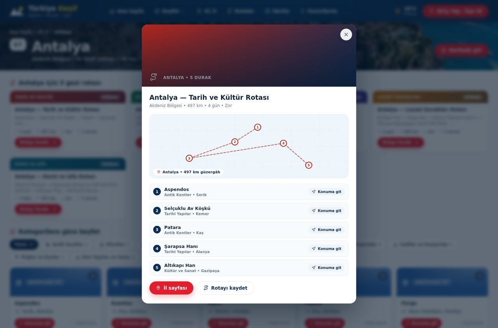
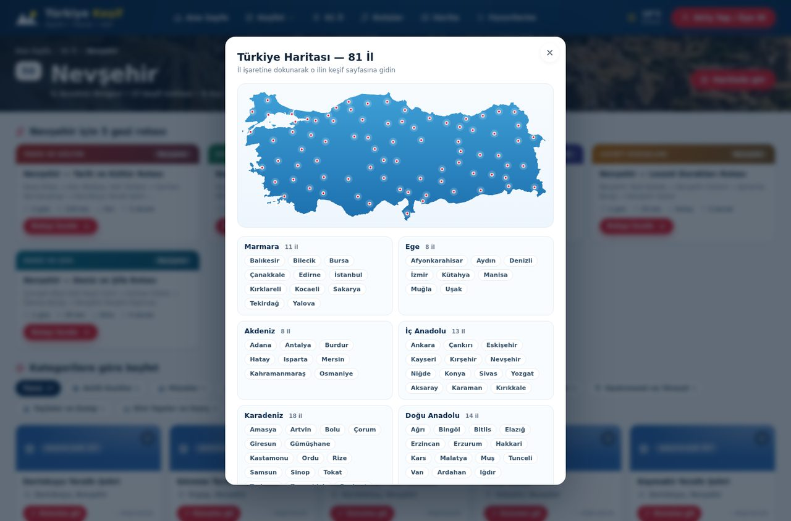
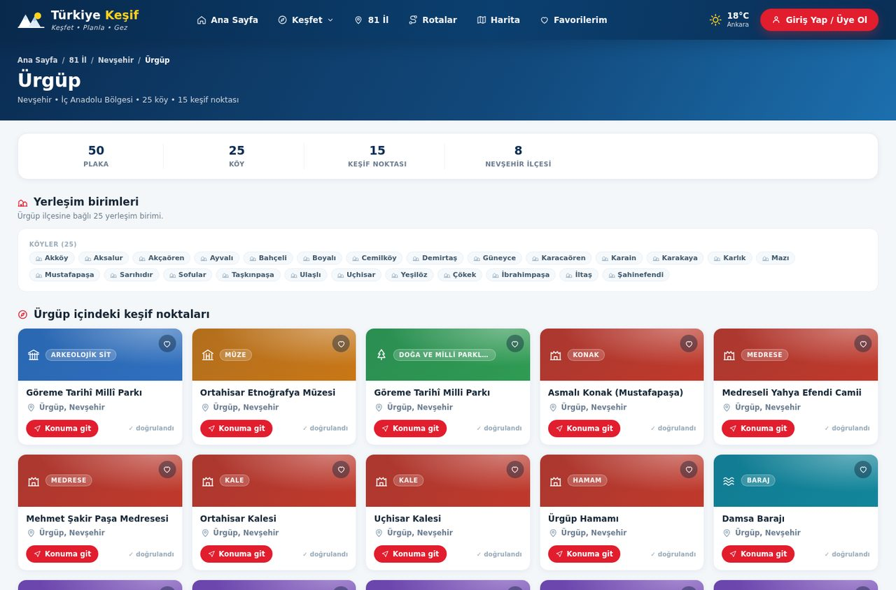
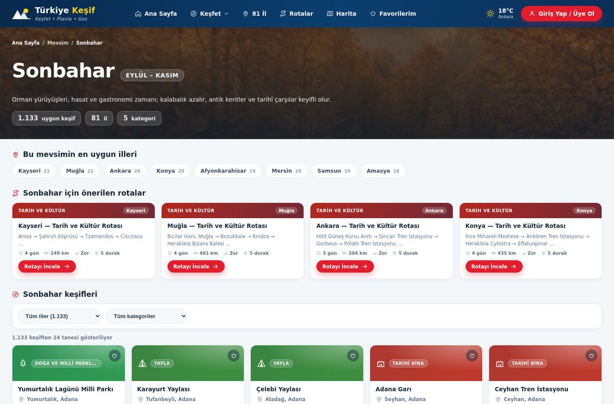
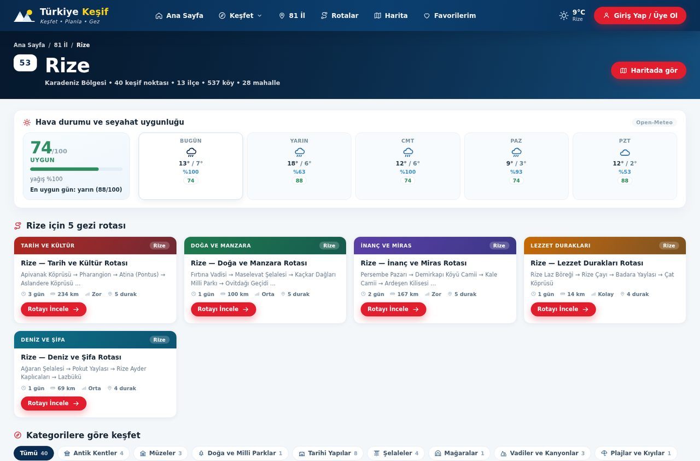

# Türkiye Keşif

**81 il · 15 turizm kategorisi · 5.881 keşif kaydı (5.001 konumlu) · 45.060 köy/mahalle · 405 gezi rotası**

🔗 **Canlı site:** <https://xharunkoca.github.io/turkiye-kesif/>

Tek dosyalık (bağımlılıksız) keşif rehberi. `index.html` içinde CSS, JavaScript, veri ve
tüm görseller base64 olarak gömülüdür — dosyayı çift tıklayıp açmak yeterlidir, internet
bağlantısı gerekmez (harici harita/kaynak bağlantıları hariç).


## Kapsam

| Öğe | Adet |
|---|---|
| İl | **81** |
| İlçe / belde | **1.004** |
| Köy | **25.206** |
| Mahalle | **19.854** |
| Toplam kırsal yerleşim | **45.060** |
| Keşif kaydı | **5.881** kayıt / **5.871** tekil yer |
| — konumu doğrulanmış | **5.001** |
| — konumu doğrulanmamış (adresle aranır) | **880** |
| Turizm kategorisi | **15** |
| Gezi rotası | **405** (her ile 5 tema) |

### 15 kategori ve envanterdeki kayıt sayısı

| # | Kategori | Kayıt |
|---|---|---|
| 1 | Antik Kentler | 838 |
| 2 | Müzeler | 927 |
| 3 | Doğa ve Milli Parklar | 476 |
| 4 | Tarihi Yapılar | 1.084 |
| 5 | Göller | 490 |
| 6 | Şelaleler | 64 |
| 7 | Mağaralar | 203 |
| 8 | Vadiler ve Kanyonlar | 185 |
| 9 | Plajlar ve Kıyılar | 75 |
| 10 | Gastronomi ve Yöresel | 123 |
| 11 | Yaylalar ve Kamp | 104 |
| 12 | Dini Yapılar ve İnanç | 955 |
| 13 | Kültür ve Sanat | 192 |
| 14 | Kaplıcalar ve Termal | 63 |
| 15 | Çarşılar ve Pazarlar | 102 |

Her kategori kartında referans istatistikleri ("genel kabul gören antik kent sayısı",
"Mavi Bayraklı plaj sayısı", "tescilli taşınmaz sayısı" vb.) `env` alanında tutulur ve
kategori sayfasında envanter şeridi olarak gösterilir.

## Ekranlar

| Adres | İçerik |
|---|---|
| `#/` | Ana sayfa: arama, 15 kategori şeridi, popüler şehirler, harita paneli, rotalar, mevsim kartları, istatistik bandı |
| `#/kesfet` | Tüm mekânlar: il / kategori / metin filtreleri, sayfalama |
| `#/iller` | 81 ilin plaka kodlu kart ızgarası |
| `#/il/<slug>` | İl sayfası: 5 rota, kategori çipleri, mekân kartları, ilçe akordeonu (köy + mahalle listeleri) |
| `#/ilce/<il-slug>/<ilce-slug>` | İlçe sayfası: yerleşim birimleri, ilçedeki keşif noktaları, komşu ilçe bağlantıları |
| `#/rotalar` | 405 rota; il ve tema filtreli |
| `#/kategori/<id>` | Kategori sayfası: açıklama, envanter şeridi, tüm Türkiye sonuçları |
| `#/mevsim/<sezon>` | Mevsim sayfası: `ilkbahar` · `yaz` · `sonbahar` · `kis` — uygun iller, önerilen rotalar, filtreli keşifler |

Mekân kartlarında ad, tür, ilçe/il, "doğrulandı" işareti ve **"Konuma git"** butonu
(kartın altında, Google Maps'e koordinatla gider) bulunur. Karta tıklayınca detay
penceresi açılır: koordinat, plaka, yakındaki keşifler, favori ve kaynak bağlantısı.
Rota penceresinde duraklar numaralı bir **mini güzergâh haritası** üzerinde gösterilir.

### Canlı hava durumu ve seyahat puanı

İl sayfalarında [Open-Meteo](https://open-meteo.com) (anahtarsız) verisiyle 5 günlük tahmin
gösterilir: günlük ikon, en yüksek/en düşük sıcaklık, yağış olasılığı ve her gün için
**0–100 seyahat uygunluğu puanı**. Puan; fırtına/kar/yağış, aşırı sıcak-soğuk, rüzgâr ve
konfor aralığına (13–25 °C) göre hesaplanır; "en uygun gün" önerilir ve rota penceresinde
tek satır özet olarak görünür. Veriler 3 saat `localStorage`'da önbelleklenir, istek 8 saniye
içinde yanıt vermezse sessizce devre dışı kalır (site çevrimdışı da çalışır).

### Mevsim katmanı

`#/mevsim/<sezon>` sayfaları her mevsim için kategori setini, uygun illeri ve temalı
rotaları bir araya getirir; ana sayfadaki mevsim kartları bu sayfalara gider.

<p align="center">
  
  
</p>
<p align="center">
  
</p>
<p align="center">
  
  
</p>

## Kurulum

Depoyu klonlayıp `index.html`'i tarayıcıda açmanız yeterli:

```bash
git clone https://github.com/xharunkoca/turkiye-kesif.git
cd turkiye-kesif
open index.html          # macOS   (Windows: start index.html / Linux: xdg-open index.html)
```

Yerel sunucu tercih edilirse:

```bash
python3 -m http.server 8000
# http://localhost:8000
```

## Derleme

`index.html` kaynaklardan üretilir. Yeniden derlemek için:

```bash
cd data && python3 build_data.py     # ≈40 sn → data/turkiye-data.json
cd .. && python3 build.py            # → index.html
```

- `build_data.py` ham Wikidata kayıtlarını (`data/raw/`) işler; bu klasör depoya
  eklenmez (≈45 MB). Sıfırdan veri toplamak için `data/fetch*.py` betikleri çalıştırılır.
- `build.py` yer tutucuları doldurur: `__CSS__`, `__JS__`, `__DATAJSON__`, `__TRPATH__`
  ve görseller için `__IMG_*__`. Doldurulmamış yer tutucu kalırsa uyarı verir.

## Dosya düzeni

```
turkiye-kesif/
├── index.html          # ÜRETİLEN tek dosya (≈2,2 MB, her şey gömülü)
├── build.py            # derleyici: şablon + css + js + veri + görseller → index.html
├── src/
│   ├── template.html   # işaretleme + ikon sprite + yer tutucular
│   ├── style.css       # tema (referans görsel dil + v2/v3 bileşenleri)
│   ├── app.js          # yönlendirici, arama, rotalar, modaller, favoriler
│   └── tr-path.txt     # Türkiye silueti (Natural Earth 10m, projeksiyona çevrilmiş)
├── data/
│   ├── build_data.py   # ham Wikidata kayıtları → turkiye-data.json
│   ├── turkiye-data.json
│   └── fetch*.py       # Wikidata SPARQL toplayıcıları (önbellekli)
├── assets/img/         # 10 JPEG (hero, 5 şehir, rota, 3 mevsim)
├── docs/screenshots/   # README görselleri
└── .github/workflows/pages.yml  # GitHub Pages dağıtımı
```

## GitHub Pages

Depoya her `push` sonrası site otomatik yayınlanır:

1. **Settings → Pages → Build and deployment → Source: GitHub Actions**
2. `main` dalına push edin (veya Actions sekmesinden *GitHub Pages'e yayınla* iş akışını çalıştırın)
3. Site adresi: `https://xharunkoca.github.io/turkiye-kesif/`

İş akışı yayından önce veriyi doğrular (81 il / 15 kategori), ardından `index.html`
kaynaklarla güncel mi diye `build.py` çıktısını karşılaştırır.

## Veri kaynakları ve doğrulama

- **Wikidata** (CC0): il/ilçe/köy/mahalle ilişkileri ve koordinatlı turistik noktalar
  (SPARQL, sonuçlar `data/raw/` içinde önbelleklenir). Sınıf eşlemeleri: antik kent,
  höyük, kale, müze, millî park, göl, şelale, mağara, kanyon, plaj, cami/külliye,
  hamam, kervansaray, bedesten/çarşı…
- **Türkçe Vikipedi resmî listeleri**: *Türkiye'deki millî parklar* (53), *tabiat parkları* (259),
  *tabiat anıtları* (117), *tabiat koruma alanları* (32) ve *illere göre müzeler* (~1.600 ad).
  Bu kayıtlarda koordinat varsa Vikipedi koordinat API'sinden alınır; yoksa kayıt yine listelenir.
- **Wikidata sınıf taraması**: kale, tarihî köprü, mağara, manastır, kilise, türbe, cami, müze,
  antik kent, göl, şelale, baraj, plaj ve kaplıca sınıflarında koordinatlı 11.474 aday toplandı.
- **İl sınırı poligonları** (`tr-cities.json`, 81 il): koordinat → doğru il/ilçe ataması.
- **Natural Earth 10m** (kamu malı): Türkiye sınır geometrisi.
- **Open-Meteo** (ücretsiz, anahtarsız): canlı hava durumu ve seyahat puanı.
- Kategori envanter sayıları resmî/derleme istatistiklerdir (TÜİK, Kültür ve Turizm
  Bakanlığı, TÜRÇEV, TÜRKPATENT vb.).

### Rotayı başlat (canlı mod)

Her rota kartında **Başlat**, rota detayında **Rotayı başlat** düğmesi vardır:

- Adım adım panel: *Durak 2 / 5*, ilerleme çubuğu, o anki durak, önceki duraktan ve
  sonraki durağa mesafe, "Yol tarifi al" (Google Maps'te o bacağın sürüş tarifi),
  "Haritada aç", **Sonraki durak / Önceki**, son durakta **Rotayı bitir**.
- **Google'da başlat / Google'da tüm rota**: rotanın tamamını tek linkte açar
  (`maps/dir/?api=1&origin=…&destination=…&waypoints=…&travelmode=driving`).

### Konum doğruluğu

- Koordinatı olan kayıtlar **"Konuma git"** ile doğrudan noktaya gider (`maps?query=lat,lon`).
- Koordinatı doğrulanamayan **871 kayıt** da listede görünür; kartında *"konum yok"* etiketi
  ve **"Haritada ara"** düğmesi bulunur → Google Maps'te *ad + ilçe + il* ile arama yapar
  (yanlış bir koordinata göndermek yerine doğru sonucu bulur).
- İlçe merkezinden 90 km'den uzak koordinatlar en yakın ilçeye taşınır (9 kayıt düzeltildi).
- İl merkezine sabitlenmiş yaklaşık koordinatlar (175 kayıt) doğrulanmamış sayılır;
  bunlar da "Haritada ara" ile ada göre aranır (gastronomi kayıtları bölgesel olduğu için il merkezi kabul edilir).
- **Hazır rotalar yalnızca konumu doğrulanmış duraklarla kurulur**; konumsuz kayıtlar rota
  üretimine hiç girmez. Rotalar kompakt kümeleme (çekirdek durak + çevresindeki en yakın
  duraklar), en yakın komşu sıralaması ve 2-opt kısaltmasıyla kurulur; aynı yerin iki kaydı
  (ör. "X Millî Parkı" / "X Milli Parkı") rotaya iki kez girmez.
- İl merkezine 220 km'den uzak aykırı koordinatlar, aynı ad + 3 km yinelenen kayıtlar ve
  jenerik adlar ("Bedesten", "Tarihî Çarşı"…) ayıklanır; köy/mahalleler en yakın ilçeye bağlanır.

## Notlar

- Arayüz tamamen Türkçedir; tipografi ve renk paleti referans tasarımdan gelir
  (lacivert `#0a2c52`, kırmızı `#e11d2e`, sarı `#ffd21e`).
- Favoriler `localStorage` (`tk-favs-v2`), rota kayıtları `tk-routes-v2` anahtarında.
- Dosya `file://` ile açıldığında da çalışır; GitHub Pages'te harici bağlantılar
  (Google Maps, Wikidata) normal şekilde açılır.

## Lisans

Kod ve üretilen görseller [MIT](LICENSE). Veri: Wikidata (CC0 1.0), Natural Earth (kamu malı).
